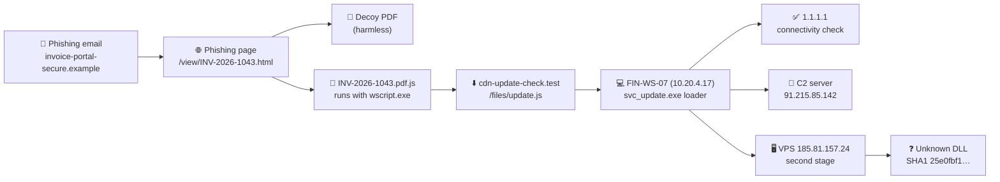

# Test dataset: "Paper Lantern"

This page documents the theoretical dataset used by the end-to-end test of **ioc-enricher** ([`tests/test_scenario.py`](../tests/test_scenario.py)).

> ⚠️ **Everything here is fictional.** The company, hosts, file hashes and every threat-intel result are invented. The `.example` and `.test` domains are reserved and never resolve. The two "malicious" public IPs are made-up numbers used only as test data, and are not a claim about whoever really owns those addresses.

| File | Content |
|---|---|
| [`tests/data/paper_lantern_report.txt`](../tests/data/paper_lantern_report.txt) | The incident report the tool reads, with defanged IOCs mixed into normal text |
| [`tests/data/paper_lantern_dataset.json`](../tests/data/paper_lantern_dataset.json) | The invented API answers for each IOC, and the expected verdict |
| [`tests/show_scenario.py`](../tests/show_scenario.py) | Prints this dataset and the tool's results in the terminal |

## The scenario

A finance employee at the fictional company *Lumen Freight* receives a fake invoice email. Clicking the link downloads a JavaScript file that installs a malware loader. The loader then connects to a command-and-control (C2) server and downloads a second stage.



### Timeline (UTC, fictional date 2026-10-28)

| Time | Event |
|---|---|
| 08:41 | Email received from `billing@invoice-portal-secure[.]example` about "overdue invoice INV-2026-1043" |
| 08:44 | User opens the link, downloads `INV-2026-1043.pdf.js`, and sees a decoy PDF |
| 08:45 | `wscript.exe` runs the script, which downloads a loader and drops `svc_update.exe` on FIN-WS-07 |
| 08:46 | The loader checks internet access via `1[.]1[.]1[.]1`, then beacons to the C2 every 60 seconds |
| 09:30 | A second-stage module is downloaded from a VPS and loads an unknown DLL |
| 09:52 | EDR isolates FIN-WS-07 |

## Summary of the 10 IOCs

| # | IOC (defanged) | Type | Role | Expected verdict | Score |
|---|---|---|---|---|---|
| 1 | `invoice-portal-secure[.]example` | domain | Lookalike phishing domain | 🔴 MALICIOUS | 100 |
| 2 | `hxxps://invoice-portal-secure[.]example/view/INV-2026-1043.html` | url | Phishing landing page | 🔴 MALICIOUS | 100 |
| 3 | `ad273fd44ad01da91126c2da5ada05c4` | md5 | Decoy PDF (harmless) | 🟢 CLEAN | 0 |
| 4 | `hxxp://cdn-update-check[.]test/files/update.js` | url | Loader download URL | 🔴 MALICIOUS | 80 |
| 5 | `10[.]20[.]4[.]17` | ipv4 | Infected internal workstation | 🔵 PRIVATE | – |
| 6 | `47c564b1a948b0ce4aef199ff63a53ee11c3fc3c073c6499250032c75ae418f9` | sha256 | Malware loader `svc_update.exe` | 🔴 MALICIOUS | 100 |
| 7 | `1[.]1[.]1[.]1` | ipv4 | Public DNS used for a connectivity check | 🟢 CLEAN | 0 |
| 8 | `91[.]215[.]85[.]142` | ipv4 | C2 server | 🔴 MALICIOUS | 100 |
| 9 | `185[.]81[.]157[.]24` | ipv4 | VPS hosting the second stage | 🟠 SUSPICIOUS | 45 |
| 10 | `25e0fbf1e994a30ddbbb1d7d0eefa74cf814bcf8` | sha1 | Brand-new DLL nobody has seen | ⚪ UNKNOWN | – |

**Total:** 5 malicious, 1 suspicious, 2 clean, 1 private, 1 unknown.

### Text that must *not* be extracted

The report also contains strings that look like IOCs but aren't. The test checks that the tool ignores them:

| String in the report | Why it's ignored |
|---|---|
| `INV-2026-1043.pdf.js`, `svc_update.exe`, `wscript.exe`, `fin-ws-07_triage.zip` | File names: `.js`, `.exe` and `.zip` are file extensions, not domain endings |
| `cdn-update-check.test` (on its own) | It only appears inside URL #4, so it isn't reported twice |
| `08:41`, `INV-2026-1043`, `FIN-WS-07` | Times, invoice numbers and hostnames aren't IOCs |

## How the score is calculated

Each source gives a score from 0 to 100, or none if it's only informational:

| Source | Rule |
|---|---|
| VirusTotal | 10+ engines → 100 · 5–9 → 85 · 2–4 → 60 · 1 engine (or 2+ "suspicious") → 30 · 0 → 0 |
| AbuseIPDB | Its abuse confidence score, as is |
| URLhaus | URL online → 95 · URL offline → 80 · host with an online URL → 90 · host with offline URLs only → 70 · known payload → 95 |
| RDAP/WHOIS | Domain registered less than 30 days ago → 40, otherwise informational |

**Final score = highest score + 10 for each additional source scoring 30 or more**, capped at 100.
70 or more → MALICIOUS · 30–69 → SUSPICIOUS · below 30 → CLEAN · no scores at all → UNKNOWN · internal IP → PRIVATE.

## Each IOC in detail

### 1. `invoice-portal-secure[.]example` (domain)

**Role:** lookalike domain used both as the email sender and to host the phishing page. It was registered 5 days before the attack.

| Source | Invented answer | Score |
|---|---|---|
| VirusTotal | 1/90 engines malicious | 30 |
| URLhaus | Host listed, 1 malware URL online, tags `phishing`, `js` | 90 |
| RDAP/WHOIS | Registered 2026-10-23 by "Fictional Registrar Ltd" (5 days old) | 40 |

**Calculation:** highest 90 + 2 other sources ≥ 30 (+20) = 110 → capped at **100 → MALICIOUS**

**Takeaway:** a single VirusTotal hit means little on its own, but combined with a 5-day-old domain and a URLhaus listing, the evidence adds up.

### 2. `hxxps://invoice-portal-secure[.]example/view/INV-2026-1043.html` (url)

**Role:** the phishing page that delivered the malicious script.

| Source | Invented answer | Score |
|---|---|---|
| VirusTotal | 8/95 engines malicious, 2 suspicious | 85 |
| URLhaus | Listed as `malware_download`, **online** | 95 |

**Calculation:** highest 95 + 1 other source ≥ 30 (+10) = 105 → capped at **100 → MALICIOUS**

### 3. `ad273fd44ad01da91126c2da5ada05c4` (md5)

**Role:** decoy PDF shown to the victim to look legitimate. It's a real invoice template with nothing malicious inside.

| Source | Invented answer | Score |
|---|---|---|
| VirusTotal | 0/70 engines malicious, file name `invoice_template.pdf` | 0 |
| URLhaus | Not listed | – |

**Calculation:** highest 0 = **0 → CLEAN**

**Takeaway:** not every file in an incident is malicious. Flagging the decoy would waste analyst time.

### 4. `hxxp://cdn-update-check[.]test/files/update.js` (url)

**Role:** second download URL. It was already taken down, and VirusTotal has never scanned it.

| Source | Invented answer | Score |
|---|---|---|
| VirusTotal | Not found | – |
| URLhaus | Listed as `malware_download`, **offline**, tags `js`, `PaperLantern` | 80 |

**Calculation:** highest 80 = **80 → MALICIOUS**

**Takeaway:** one reliable source is enough, even if another source has never seen the IOC.

### 5. `10[.]20[.]4[.]17` (ipv4)

**Role:** the infected workstation FIN-WS-07 on the internal network.

| Source | Invented answer | Score |
|---|---|---|
| All sources | **Never queried** | – |

**Verdict:** **PRIVATE**

**Takeaway:** internal addresses must never be sent to public services, because that would leak information about the company's network. The test fails if any request contains this IP.

### 6. `47c564b1…5ae418f9` (sha256)

**Role:** the malware loader `svc_update.exe` dropped on the workstation.

| Source | Invented answer | Score |
|---|---|---|
| VirusTotal | 41/72 engines malicious, label `trojan.paperlantern/loader`, Win32 EXE, 241 KB | 100 |
| URLhaus | Known payload, family `PaperLantern`, delivered by 3 URLs | 95 |

**Calculation:** highest 100 + 1 other source ≥ 30 (+10) → capped at **100 → MALICIOUS**

**Takeaway:** the malware family name (`PaperLantern`) reaches the analyst, which helps find related IOCs and reports.

### 7. `1[.]1[.]1[.]1` (ipv4)

**Role:** a public DNS resolver the malware contacted to check it had internet access. It's a classic false-positive trap, because it shows up in the incident but isn't malicious.

| Source | Invented answer | Score |
|---|---|---|
| VirusTotal | 0/93 engines malicious | 0 |
| AbuseIPDB | Confidence 0%, 12 reports, Content Delivery Network | 0 |
| URLhaus | Not listed | – |
| RDAP/WHOIS | APNIC and Cloudflare DNS Resolver project, AU | info only |

**Calculation:** highest 0 = **0 → CLEAN**

**Takeaway:** a few reports on AbuseIPDB don't make an IP malicious when the confidence score is 0%. Blocking it would break DNS for the company.

### 8. `91[.]215[.]85[.]142` (ipv4)

**Role:** the command-and-control server the loader beaconed to every 60 seconds.

| Source | Invented answer | Score |
|---|---|---|
| VirusTotal | 12/93 engines malicious | 100 |
| AbuseIPDB | Confidence 100%, 318 reports from 74 users, hosting provider | 100 |
| URLhaus | Not listed | – |
| RDAP/WHOIS | FICTIONAL-HOSTING-NET | info only |

**Calculation:** highest 100 + 1 other source ≥ 30 (+10) → capped at **100 → MALICIOUS**

### 9. `185[.]81[.]157[.]24` (ipv4)

**Role:** VPS that hosted the second stage. During triage, the VirusTotal lookup hit the API rate limit.

| Source | Invented answer | Score |
|---|---|---|
| VirusTotal | **HTTP 429: rate limited** (error) | – |
| AbuseIPDB | Confidence 45%, 9 reports from 6 users | 45 |
| URLhaus | Not listed | – |
| RDAP/WHOIS | CHEAP-VPS-NET | info only |

**Calculation:** highest 45 = **45 → SUSPICIOUS**

**Takeaway:** when one source fails, the tool doesn't crash. It reports the error and still gives a verdict from the other sources. An analyst would re-check VirusTotal later.

### 10. `25e0fbf1e994a30ddbbb1d7d0eefa74cf814bcf8` (sha1)

**Role:** a brand-new DLL loaded by the second stage that no sandbox has analysed yet.

| Source | Invented answer | Score |
|---|---|---|
| VirusTotal | Not found | – |
| URLhaus | Not queried (URLhaus can't search by SHA1) | – |

**Verdict:** **UNKNOWN**

**Takeaway:** UNKNOWN doesn't mean safe. This DLL came from a malicious server, so in a real SOC it would be sent to a sandbox for analysis.

## What the test checks

| Check | IOC(s) involved |
|---|---|
| All 10 IOCs are extracted from the report, in order, with nothing extra | All |
| Every verdict and score matches the tables above | All |
| The internal IP is never sent to any source | #5 |
| A rate-limited source doesn't break the verdict | #9 |
| The newly registered domain is flagged (age = 5 days) | #1 |
| Sources only receive IOC types they support (no SHA1 to URLhaus, no domains to AbuseIPDB) | #10, all |
| The malware family and threat label reach the analyst | #6 |
| The Markdown ticket output is fully defanged | All |
| The command `ioc-enricher --extract … --fail-on malicious` exits with code 2 | All |

## Run it yourself

From the `ioc-enricher` folder, with the virtual environment active:

```bash
pytest tests/test_scenario.py -v     # run the scenario test
python tests/show_scenario.py        # print the dataset and the tool's results
```

Neither command needs API keys or an internet connection.
