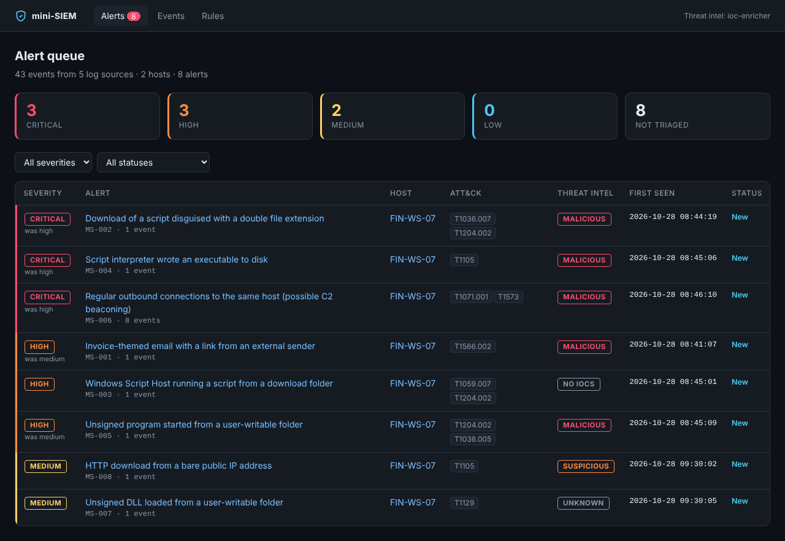
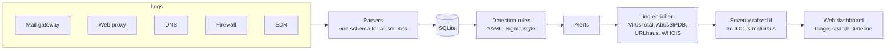
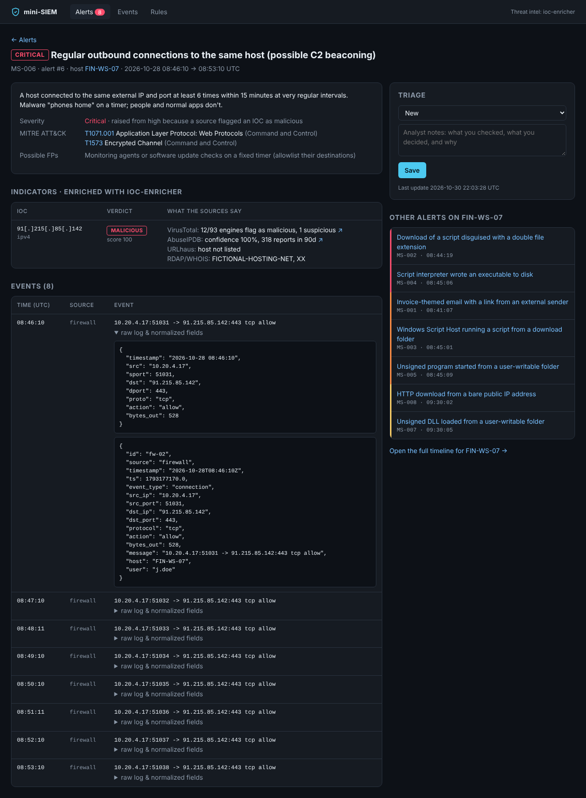
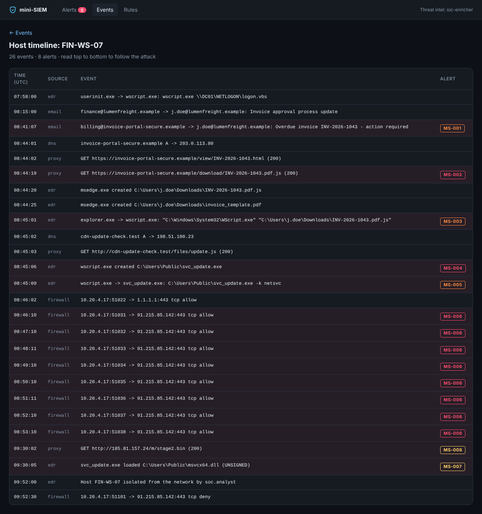

# mini-siem

[](https://github.com/Hauptfam/Becode-2026/actions/workflows/mini-siem-ci.yml)


A small, readable SIEM built to learn how SOC tooling works from the inside. It collects logs from five sources, normalizes them, runs detection rules mapped to **MITRE ATT&CK**, raises alerts, enriches their indicators with my [ioc-enricher](../ioc-enricher/) tool, and gives analysts a web dashboard to triage them.



## What it does



- **5 log sources with their own formats**: mail gateway, web proxy (Apache-style timestamps), DNS (epoch timestamps), firewall and EDR, all normalized into one schema so one rule language works everywhere.
- **Asset inventory**: IPs and mailboxes are mapped to hostnames and users, so a firewall line becomes "FIN-WS-07 (j.doe)".
- **Detection rules in YAML**, inspired by [Sigma](https://github.com/SigmaHQ/sigma): field modifiers (`contains`, `re`, `cidr`, `gte`, ...), boolean conditions (`selection and not filter`), and **aggregation rules** that detect patterns like C2 beaconing (same destination, at least 6 times in 15 minutes, at regular intervals).
- **8 built-in rules** covering a full phishing-to-C2 chain, each with its ATT&CK technique, a description and known false positives.
- **Threat-intel enrichment**: every alert's IOCs (domains, URLs, public IPs, hashes) are checked with ioc-enricher. An alert with a malicious IOC is escalated one severity level. Internal IPs are never sent outside.
- **Analyst workflow**: alert statuses (new, in progress, closed as true or false positive) with notes. Re-running detection keeps the analyst's work.
- **Web dashboard**: alert queue, alert investigation page, full-text event search, host timeline, rule list, and a JSON API for automation.
- **A realistic test scenario** with 43 log events, where benign traffic that *looks* suspicious must not trigger alerts.

## Quick start

Requires Python 3.10+. From the root of the repository:

```bash
cd mini-siem
python -m venv .venv
source .venv/bin/activate          # Windows PowerShell: .venv\Scripts\Activate.ps1
pip install -e ../ioc-enricher -e ".[dev]"

mini-siem demo
```

Then open **http://127.0.0.1:5000**. The `demo` command loads the fictional *Paper Lantern* incident, runs detection, enriches the alerts offline (no API keys needed) and starts the dashboard.

```text
[1/4] ingest   paper_lantern_logs.json
      43 events from 5 sources
[2/4] detect
      8 alerts
[3/4] enrich   offline threat intel from paper_lantern_dataset.json: 8 IOCs, 5 alerts escalated
[4/4] serve
mini-SIEM dashboard: http://127.0.0.1:5000  (Ctrl+C to stop)
```

## Screenshots

| Alert investigation | Host timeline |
|---|---|
|  |  |

The alert page shows the rule's ATT&CK mapping, the IOCs with what each threat-intel source says, the raw and normalized events, and a triage form. The host timeline lets you read an attack from top to bottom, with each alert next to the event that caused it.

## The demo scenario: "Paper Lantern"

The same fictional incident as the ioc-enricher test, seen from the logs this time: a finance employee opens a fake invoice email, runs a script disguised as a PDF, a loader is installed and starts beaconing to a C2 server, then downloads a second stage.

| # | Rule | ATT&CK | Severity | After enrichment |
|---|---|---|---|---|
| MS-001 | Invoice-themed email with a link from an external sender | T1566.002 | medium | 🔴 **high** (malicious domain) |
| MS-002 | Download of a script disguised with a double file extension | T1036.007, T1204.002 | high | 🔴 **critical** |
| MS-003 | Windows Script Host running a script from a download folder | T1059.007, T1204.002 | high | high (no IOCs) |
| MS-004 | Script interpreter wrote an executable to disk | T1105 | high | 🔴 **critical** (known malware hash) |
| MS-005 | Unsigned program started from a user-writable folder | T1204.002, T1036.005 | medium | 🔴 **high** |
| MS-006 | Regular outbound connections to the same host (C2 beaconing) | T1071.001, T1573 | high | 🔴 **critical** (C2 IP) |
| MS-007 | Unsigned DLL loaded from a user-writable folder | T1129 | medium | medium (hash unknown) |
| MS-008 | HTTP download from a bare public IP address | T1105 | medium | medium (IP suspicious) |

A second workstation produces **look-alike benign traffic that must stay silent**: Teams connections to one IP (frequent but irregular, so not beaconing), a `.js` library from a CDN, a printer driver downloaded from an internal IP, a logon script run by `wscript.exe` from NETLOGON, and Windows Defender running from `C:\ProgramData`.

📄 Every event, its role and the rules it must trigger: **[docs/paper-lantern-logs.md](docs/paper-lantern-logs.md)**

## Usage

```bash
mini-siem demo [--port 5000] [--no-serve]        # load the scenario and start the dashboard

mini-siem ingest data/paper_lantern_logs.json    # a scenario dataset (with assets)
mini-siem ingest --source proxy my_proxy.jsonl   # your own logs: JSON array or JSON Lines
mini-siem detect                                  # run all rules
mini-siem enrich                                  # real APIs, keys from .env
mini-siem enrich --offline-dataset intel.json     # or an offline threat-intel dataset
mini-siem alerts [--json]                         # list alerts in the terminal
mini-siem serve                                   # dashboard on http://127.0.0.1:5000
mini-siem reset                                   # empty the database

mini-siem --db other.db --rules my_rules/ detect  # another database or rule folder
```

For real enrichment, copy `.env.example` to `.env` and add your free VirusTotal, AbuseIPDB and URLhaus keys (see the [ioc-enricher README](../ioc-enricher/README.md#api-keys)).

## Writing a rule

Rules are YAML files in [`src/mini_siem/rules/`](src/mini_siem/rules/). This one catches `wscript.exe` running a script from the Downloads folder, but not the legitimate logon script that runs from the NETLOGON share:

```yaml
id: MS-003
title: Windows Script Host running a script from a download folder
severity: high                          # low | medium | high | critical
logsource: edr                          # email | proxy | dns | firewall | edr
mitre:
  - {id: T1059.007, name: "Command and Scripting Interpreter: JavaScript", tactic: Execution}
detection:
  selection:
    event_type: process_start
    process_name: [wscript.exe, cscript.exe, mshta.exe]      # a list means "any of"
    command_line|contains: ['\Downloads\', '\AppData\Local\Temp\']
  condition: selection
falsepositives:
  - A user manually running an IT-provided script they downloaded
```

| Modifier | Meaning | Example |
|---|---|---|
| *(none)* | equals (case-insensitive) | `process_name: wscript.exe` |
| `contains`, `startswith`, `endswith` | substring match | `command_line\|contains: '\Downloads\'` |
| `re` | regular expression | `url\|re: '\.pdf\.js$'` |
| `cidr` | IP in a network | `dst_ip\|cidr: 10.0.0.0/8` |
| `gt`, `gte`, `lt`, `lte` | number comparison | `url_count\|gte: 1` |
| `exists` | field present or not | `sha256\|exists: true` |
| `all` | every value in the list must match | `command_line\|contains\|all: [-enc, -nop]` |

Conditions combine named selections with `and`, `or`, `not` and parentheses. For patterns across many events, add an `aggregation` block (see [MS-006](src/mini_siem/rules/MS-006_c2_beaconing.yml)).

<details>
<summary><b>Normalized fields available to rules</b></summary>

| Field | Sources |
|---|---|
| `timestamp`, `source`, `event_type`, `host`, `user`, `message` | all |
| `src_ip`, `dst_ip`, `src_port`, `dst_port`, `protocol`, `action`, `bytes_out` | firewall (and proxy / dns for IPs) |
| `url`, `domain`, `http_method`, `http_status`, `content_type`, `user_agent` | proxy |
| `domain`, `dns_type`, `dns_rcode`, `answers` | dns |
| `sender`, `sender_domain`, `recipient`, `subject`, `urls`, `url_count`, `attachments`, `spf` | email |
| `process_name`, `process_path`, `command_line`, `parent_name`, `file_path`, `file_name`, `sha256`, `sha1`, `md5`, `signed` | edr |

</details>

## Project structure

```
mini-siem/
├── data/paper_lantern_logs.json   # theoretical log dataset (43 events + expected alerts)
├── docs/                          # dataset documentation and screenshots
├── src/mini_siem/
│   ├── parsers.py     # 5 log formats -> one schema, asset inventory
│   ├── rules.py       # YAML rule format, condition parser, field matching, aggregation
│   ├── engine.py      # ingest -> detect -> enrich pipeline
│   ├── store.py       # SQLite: events, alerts, IOCs
│   ├── web.py         # Flask dashboard + JSON API
│   ├── cli.py         # command-line interface
│   ├── rules/         # the 8 detection rules
│   └── templates/     # dashboard pages
└── tests/             # 115 tests, offline
```

## Tests

```bash
pytest            # 115 tests, no network or API keys needed
```

The main test ([`tests/test_scenario.py`](tests/test_scenario.py)) runs the whole pipeline on the Paper Lantern dataset and checks, **for each of the 43 events**, that it triggers exactly the rules the dataset expects (and that benign events stay silent). It then checks every alert's severity before and after enrichment, that internal IPs are never sent to threat-intel sources, and that log content is escaped in the dashboard (log data is attacker-controlled).

## Limitations

This is a learning project, not a production SIEM. It processes logs in batches rather than streaming, keeps everything in one SQLite file, has no login on the dashboard (it listens on `127.0.0.1` only by default), and its rule language covers a useful subset of Sigma, not all of it.

## License

MIT
