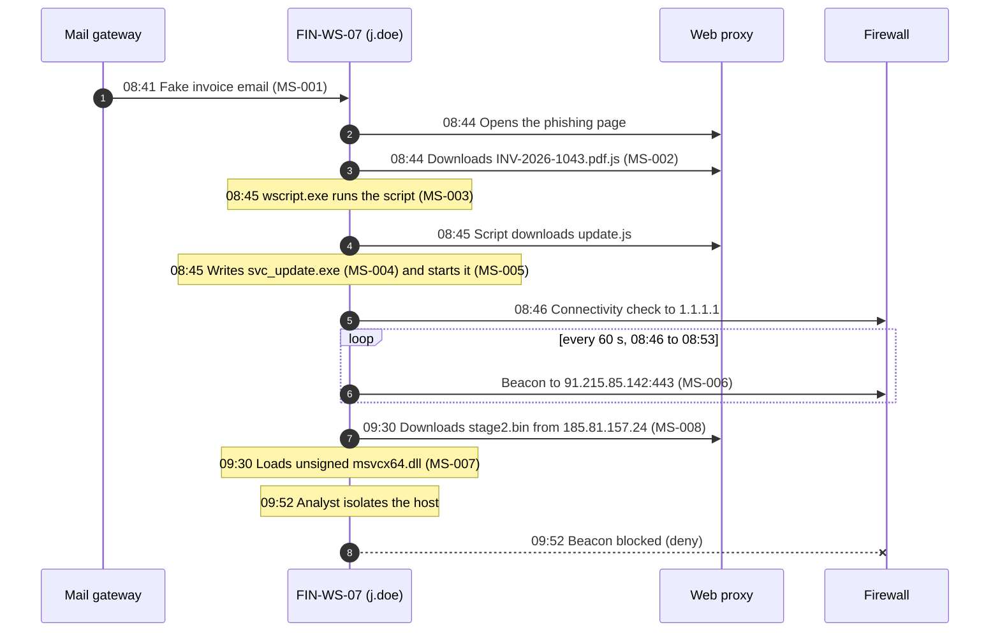

# Test dataset: "Paper Lantern" logs

This page documents the theoretical log dataset used by **mini-siem** ([`data/paper_lantern_logs.json`](../data/paper_lantern_logs.json)). It describes the same fictional incident as the [ioc-enricher dataset](../../ioc-enricher/docs/paper-lantern-dataset.md), but as the raw logs a SOC would collect, so the two tools can be tested together.

> ⚠️ **Everything here is fictional.** The company, people, hosts, file hashes and threat-intel results are invented. The `.example` and `.test` domains are reserved and never resolve.

## Same format as the IOC dataset

Both datasets follow the same idea: each item says **what it is** (`role`) and **what the tool must do with it** (`expected`), so the test can check every single line.

| | ioc-enricher dataset | mini-siem dataset |
|---|---|---|
| File | `ioc-enricher/tests/data/paper_lantern_dataset.json` | `mini-siem/data/paper_lantern_logs.json` |
| One item | an **indicator** (IP, domain, URL, hash) | a **log event** (email, proxy, DNS, firewall, EDR) |
| Item content | invented answers from VirusTotal, AbuseIPDB, URLhaus, RDAP | the raw log record, with its source's native field names |
| `role` | what the indicator is in the attack | what the event is in the attack (or why it's benign) |
| Expected result | `expected.verdict` and `expected.score` | `expected_rules` (`[]` = must stay silent) |
| Summary | verdict distribution | `expected_alerts`: severity before and after enrichment |

The log dataset also points to the IOC dataset (`"threat_intel_dataset"`), which mini-siem uses as its offline threat-intel source.

```json
{
  "scenario": "Paper Lantern",
  "threat_intel_dataset": "../../ioc-enricher/tests/data/paper_lantern_dataset.json",
  "assets": [
    {"hostname": "FIN-WS-07", "ip": "10.20.4.17", "user": "j.doe", "email": "j.doe@lumenfreight.example", "department": "Finance"}
  ],
  "events": [
    {
      "id": "edr-07",
      "source": "edr",
      "role": "User double-clicks the file: wscript.exe runs the script from Downloads",
      "expected_rules": ["MS-003"],
      "record": {
        "@timestamp": "2026-10-28T08:45:01Z", "hostname": "FIN-WS-07", "user": "j.doe", "event_type": "process_start",
        "process": {"name": "wscript.exe", "command_line": "\"C:\\Windows\\System32\\WScript.exe\" \"C:\\Users\\j.doe\\Downloads\\INV-2026-1043.pdf.js\"", "parent_name": "explorer.exe", "signed": true}
      }
    }
  ],
  "expected_alerts": [
    {"rule": "MS-003", "host": "FIN-WS-07", "events": ["edr-07"], "severity": "high", "ti_verdict": "NONE", "severity_after_enrichment": "high"}
  ]
}
```

## The environment

| Host | IP | User | Role in the dataset |
|---|---|---|---|
| **FIN-WS-07** | 10.20.4.17 | j.doe (Finance) | The victim: everything from the phishing email to the C2 beaconing happens here |
| **HR-WS-02** | 10.20.6.31 | a.martin (HR) | Normal activity designed to **look** suspicious, to test for false positives |
| DC01 | 10.20.0.10 | – | Domain controller and file server |

## The attack, as the logs see it



## Expected alerts

| Rule | What it detects | Events | Severity | IOC verdict (ioc-enricher) | After enrichment |
|---|---|---|---|---|---|
| MS-001 | Invoice-themed email with a link from an external sender | `mail-02` | medium | MALICIOUS (lookalike domain, phishing URL) | **high** |
| MS-002 | Script disguised with a double extension (`.pdf.js`) | `proxy-04` | high | MALICIOUS (domain) | **critical** |
| MS-003 | `wscript.exe` running a script from Downloads | `edr-07` | high | no external IOC in the event | high |
| MS-004 | Script interpreter wrote an executable to disk | `edr-08` | high | MALICIOUS (loader SHA256) | **critical** |
| MS-005 | Unsigned program started from `C:\Users\Public` | `edr-09` | medium | MALICIOUS (loader SHA256) | **high** |
| MS-006 | Regular connections to one IP: C2 beaconing | `fw-02` to `fw-09` (8) | high | MALICIOUS (C2 IP) | **critical** |
| MS-007 | Unsigned DLL loaded from a user folder | `edr-10` | medium | UNKNOWN (no source knows the DLL) | medium |
| MS-008 | HTTP download from a bare public IP | `proxy-08` | medium | SUSPICIOUS (VPS IP, 45% on AbuseIPDB) | medium |

**Rule for escalation:** if any IOC in an alert is MALICIOUS, the alert goes up one severity level. SUSPICIOUS or UNKNOWN doesn't change it, but the analyst sees the verdict on the alert.

**Result:** 8 alerts, all on FIN-WS-07: 3 critical, 3 high, 2 medium. HR-WS-02 has **zero** alerts.

## False-positive traps

The benign events are as important as the malicious ones. Each one is built to look like an attack and checks that a rule is precise enough:

| Event | Looks like... | Why it must stay silent | Rule it tests |
|---|---|---|---|
| `mail-01` | An invoice email with a link | It comes from our own domain (`lumenfreight.example`) | MS-001 |
| `proxy-02` | A JavaScript download | A normal library (`jquery.min.js`), no double extension | MS-002 |
| `proxy-07` | A download from a bare IP | The IP is internal (`10.20.0.50`, printer driver server) | MS-008 |
| `fw-10` to `fw-16` | 7 connections to one IP in 14 minutes, like the C2 | Teams traffic at **irregular** intervals; beacons are regular | MS-006 |
| `fw-17` | A connection to the C2 IP | It was **denied** after isolation, so it isn't beaconing | MS-006 |
| `edr-01` | `wscript.exe` running a script | A logon script from the NETLOGON share, not from Downloads | MS-003 |
| `edr-03` | A DLL load | Signed DLL from `C:\Program Files` | MS-007 |
| `edr-04` | A program running from `C:\ProgramData` | Windows Defender, which is **signed** | MS-005 |

The Teams trap is the hardest one: without the "regular intervals" check (`max_jitter: 5`), MS-006 would fire on it. The test suite verifies this.

## All 43 events

Times are UTC on 2026-10-28. Each source uses its own timestamp format, and mini-siem converts them all to one timeline.

### Mail gateway (`email`, 3 events)

Native timestamp format: `2026-10-28T08:15:00Z`

| ID | Time | Host | What happens | Expected rules |
|---|---|---|---|---|
| `mail-01` | 08:15:00 | FIN-WS-07 | Internal finance email about invoices: same keywords as phishing, but from our own domain | none ✅ |
| `mail-02` | 08:41:07 | FIN-WS-07 | THE PHISHING EMAIL: fake overdue invoice from the lookalike domain | **MS-001** |
| `mail-03` | 09:05:12 | HR-WS-02 | Normal email from a partner with an attachment and no link | none ✅ |

### Web proxy (`proxy`, 8 events)

Native timestamp format: `28/Oct/2026:08:30:12 +0000`

| ID | Time | Host | What happens | Expected rules |
|---|---|---|---|---|
| `proxy-01` | 08:30:12 | HR-WS-02 | Normal browsing on the HR workstation | none ✅ |
| `proxy-02` | 08:32:40 | HR-WS-02 | Legitimate JavaScript library from a CDN: a .js download, but not a double extension | none ✅ |
| `proxy-03` | 08:44:02 | FIN-WS-07 | Victim opens the phishing page from the email link | none ✅ |
| `proxy-04` | 08:44:19 | FIN-WS-07 | Victim downloads INV-2026-1043.pdf.js (a script pretending to be a PDF) | **MS-002** |
| `proxy-05` | 08:45:03 | FIN-WS-07 | The script downloads the loader from the second URL (plain .js, legacy script user agent) | none ✅ |
| `proxy-06` | 09:10:00 | HR-WS-02 | Expense report PDF from the intranet | none ✅ |
| `proxy-07` | 09:20:41 | HR-WS-02 | Printer driver from an INTERNAL server addressed by IP: must not trigger the bare-IP rule | none ✅ |
| `proxy-08` | 09:30:02 | FIN-WS-07 | Loader downloads the second stage from a VPS addressed by its IP | **MS-008** |

### DNS server (`dns`, 3 events)

Native timestamp format: `1793176211.0`

| ID | Time | Host | What happens | Expected rules |
|---|---|---|---|---|
| `dns-01` | 08:30:11 | HR-WS-02 | HR workstation resolves Wikipedia | none ✅ |
| `dns-02` | 08:44:01 | FIN-WS-07 | Victim resolves the phishing domain | none ✅ |
| `dns-03` | 08:45:02 | FIN-WS-07 | Script resolves the loader download domain | none ✅ |

### Firewall (`firewall`, 18 events)

Native timestamp format: `2026-10-28 08:20:15`

| ID | Time | Host | What happens | Expected rules |
|---|---|---|---|---|
| `fw-18` | 08:20:15 | HR-WS-02 | Internal file share traffic (private destination) | none ✅ |
| `fw-10` | 08:31:00 | HR-WS-02 | Microsoft Teams traffic 1/7: 7 connections to one IP within 14 min, like the C2, but at IRREGULAR intervals (not beaconing) | none ✅ |
| `fw-11` | 08:31:07 | HR-WS-02 | Microsoft Teams traffic 2/7: 7 connections to one IP within 14 min, like the C2, but at IRREGULAR intervals (not beaconing) | none ✅ |
| `fw-12` | 08:33:40 | HR-WS-02 | Microsoft Teams traffic 3/7: 7 connections to one IP within 14 min, like the C2, but at IRREGULAR intervals (not beaconing) | none ✅ |
| `fw-13` | 08:34:02 | HR-WS-02 | Microsoft Teams traffic 4/7: 7 connections to one IP within 14 min, like the C2, but at IRREGULAR intervals (not beaconing) | none ✅ |
| `fw-14` | 08:38:30 | HR-WS-02 | Microsoft Teams traffic 5/7: 7 connections to one IP within 14 min, like the C2, but at IRREGULAR intervals (not beaconing) | none ✅ |
| `fw-15` | 08:42:12 | HR-WS-02 | Microsoft Teams traffic 6/7: 7 connections to one IP within 14 min, like the C2, but at IRREGULAR intervals (not beaconing) | none ✅ |
| `fw-16` | 08:44:59 | HR-WS-02 | Microsoft Teams traffic 7/7: 7 connections to one IP within 14 min, like the C2, but at IRREGULAR intervals (not beaconing) | none ✅ |
| `fw-01` | 08:46:02 | FIN-WS-07 | Loader checks internet access via 1.1.1.1 (benign destination) | none ✅ |
| `fw-02` | 08:46:10 | FIN-WS-07 | C2 beacon 1/8: every 60 s (+/- 1 s) to the C2 server | **MS-006** |
| `fw-03` | 08:47:10 | FIN-WS-07 | C2 beacon 2/8: every 60 s (+/- 1 s) to the C2 server | **MS-006** |
| `fw-04` | 08:48:11 | FIN-WS-07 | C2 beacon 3/8: every 60 s (+/- 1 s) to the C2 server | **MS-006** |
| `fw-05` | 08:49:10 | FIN-WS-07 | C2 beacon 4/8: every 60 s (+/- 1 s) to the C2 server | **MS-006** |
| `fw-06` | 08:50:10 | FIN-WS-07 | C2 beacon 5/8: every 60 s (+/- 1 s) to the C2 server | **MS-006** |
| `fw-07` | 08:51:11 | FIN-WS-07 | C2 beacon 6/8: every 60 s (+/- 1 s) to the C2 server | **MS-006** |
| `fw-08` | 08:52:10 | FIN-WS-07 | C2 beacon 7/8: every 60 s (+/- 1 s) to the C2 server | **MS-006** |
| `fw-09` | 08:53:10 | FIN-WS-07 | C2 beacon 8/8: every 60 s (+/- 1 s) to the C2 server | **MS-006** |
| `fw-17` | 09:52:30 | FIN-WS-07 | Beacon attempt after isolation is blocked (deny): must not count as beaconing | none ✅ |

### EDR (endpoint) (`edr`, 11 events)

Native timestamp format: `2026-10-28T07:58:00Z`

| ID | Time | Host | What happens | Expected rules |
|---|---|---|---|---|
| `edr-01` | 07:58:00 | FIN-WS-07 | Logon script run by wscript.exe from the NETLOGON share (legitimate admin script) | none ✅ |
| `edr-04` | 08:00:05 | HR-WS-02 | Windows Defender runs from C:\ProgramData (user-writable path, but signed) | none ✅ |
| `edr-02` | 08:20:00 | HR-WS-02 | User opens Chrome | none ✅ |
| `edr-03` | 08:20:01 | HR-WS-02 | Chrome loads its own signed DLL from Program Files | none ✅ |
| `edr-05` | 08:44:20 | FIN-WS-07 | Browser saves the fake invoice script to Downloads | none ✅ |
| `edr-06` | 08:44:25 | FIN-WS-07 | Browser saves the decoy PDF (harmless) | none ✅ |
| `edr-07` | 08:45:01 | FIN-WS-07 | User double-clicks the file: wscript.exe runs the script from Downloads | **MS-003** |
| `edr-08` | 08:45:06 | FIN-WS-07 | The script writes the loader to C:\Users\Public | **MS-004** |
| `edr-09` | 08:45:09 | FIN-WS-07 | The loader starts (unsigned, from C:\Users\Public) | **MS-005** |
| `edr-10` | 09:30:05 | FIN-WS-07 | The loader loads the unknown second-stage DLL | **MS-007** |
| `edr-11` | 09:52:00 | FIN-WS-07 | Analyst isolates the workstation from the network | none ✅ |

## Run it yourself

From the `mini-siem` folder, with the virtual environment active:

```bash
mini-siem demo                       # load this dataset and open the dashboard
pytest tests/test_scenario.py -v     # check every event and alert against this dataset
```
