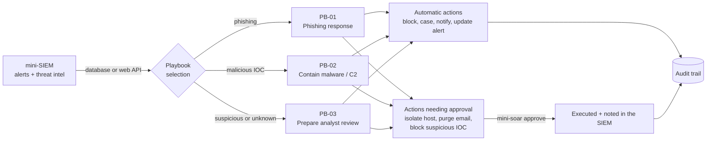
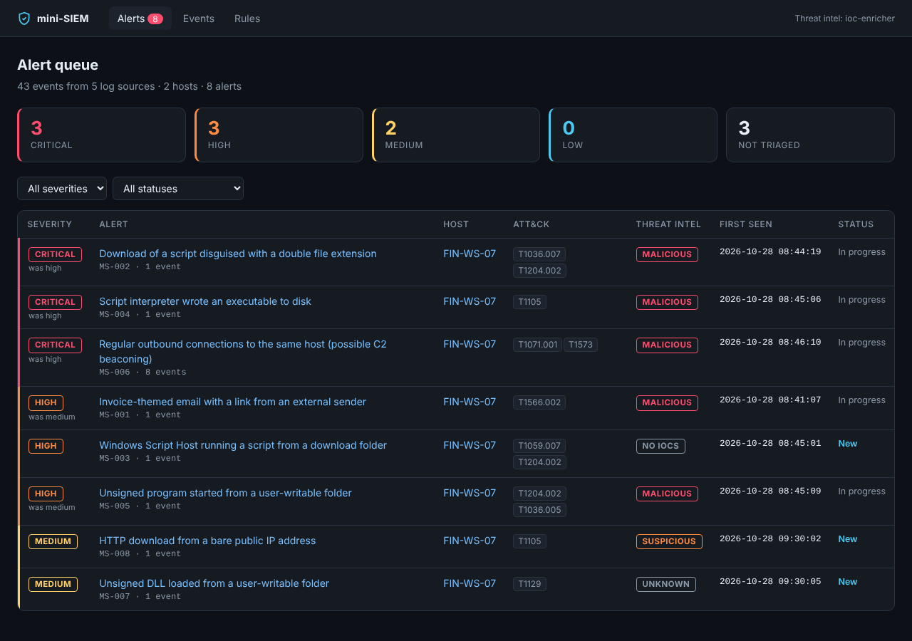
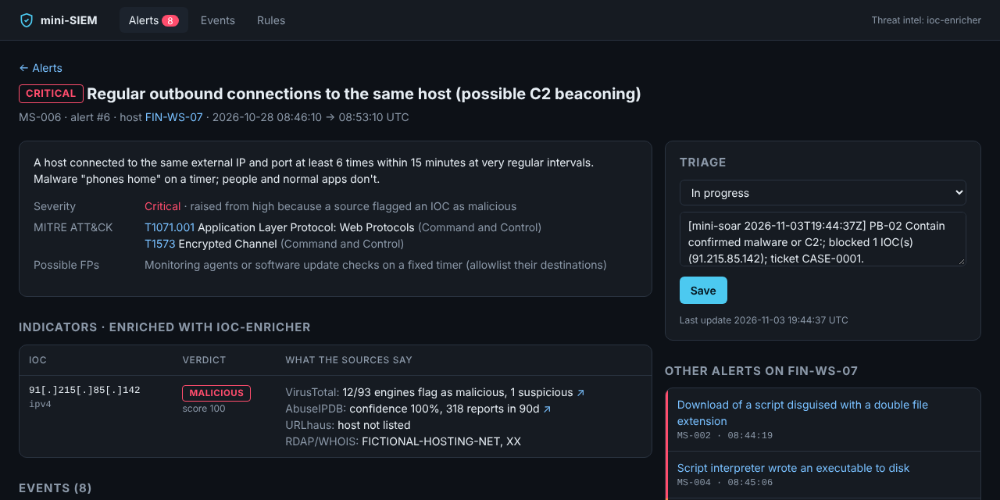

# mini-soar

[](https://github.com/Hauptfam/Becode-2026/actions/workflows/mini-soar-ci.yml)


A small **SOAR** (Security Orchestration, Automation and Response) that acts on the alerts of my [mini-SIEM](../mini-siem/). The SIEM *sees* (it detects attacks and enriches them with [ioc-enricher](../ioc-enricher/)); the SOAR *acts*: it runs playbooks that block indicators, open incident cases, notify the team and update the alerts. Risky actions wait for an analyst's approval.



## What it does

- **Reads alerts** from the mini-SIEM, either its SQLite database or its JSON API while the dashboard runs.
- **Picks one playbook per alert** (YAML files with a priority and trigger conditions on rule, severity and threat-intel verdict).
- **Runs response actions:**

  | Action | What it does | Approval |
  |---|---|---|
  | `block_ioc` | Adds indicators to blocklist files (`ips.txt`, `domains.txt`, `urls.txt`, `hashes.txt`) that a firewall, proxy or EDR can import | Automatic for MALICIOUS, approval for SUSPICIOUS |
  | `create_ticket` | Opens **one case per host** (Markdown) and adds every alert of the incident to it, with indicators, events, actions and open approvals | Automatic |
  | `notify` | Sends a message to Discord or Slack (webhook), or to `notifications.log` | Automatic |
  | `update_alert` | Writes a summary into the alert's notes in the SIEM and sets it to *In progress* | Automatic |
  | `isolate_host` | *Simulated:* asks the EDR to cut the computer off the network | **Required** |
  | `purge_email` | *Simulated:* deletes the phishing email from every mailbox | **Required** |

- **Keeps humans in charge:** actions that disrupt users wait for `mini-soar approve`. Each approval or rejection is recorded with the analyst's name and written into the SIEM alert.
- **Never blocks what it shouldn't:** private and internal IPs are always refused, and an [allowlist](src/mini_soar/allowlist.yml) protects your own domain and critical services (public DNS resolvers). Only MALICIOUS indicators are blocked automatically. UNKNOWN is never blocked, because unknown doesn't mean bad.
- **Never undoes an analyst's work:** it appends to the alert's notes instead of overwriting them, and never reopens a closed alert.
- **Keeps an audit trail** of every action: what, on which target, the result, who approved it, and when.
- **Is safe to re-run:** an alert is handled once per playbook, an indicator is blocked once, and the same approval is never requested twice.
- **Has a dry-run mode** that shows what would happen without changing anything.

## Quick start

From the root of the repository:

```bash
cd mini-soar
python -m venv .venv
source .venv/bin/activate          # Windows PowerShell: .venv\Scripts\Activate.ps1
pip install -e ../ioc-enricher -e ../mini-siem -e ".[dev]"

mini-soar demo
```

The demo builds a mini-SIEM database with the fictional *Paper Lantern* incident, runs the playbooks and shows what waits for an analyst:

```text
[2/3] mini-SOAR: run the playbooks
  #2   MS-002  -> PB-02 Contain confirmed malware or C2
  #4   MS-004  -> PB-02 Contain confirmed malware or C2
  #6   MS-006  -> PB-02 Contain confirmed malware or C2
  #1   MS-001  -> PB-01 Phishing response
  #3   MS-003  -> PB-03 Prepare analyst review
  #5   MS-005  -> PB-02 Contain confirmed malware or C2
  #8   MS-008  -> PB-03 Prepare analyst review
  #7   MS-007  -> PB-03 Prepare analyst review

8 alert(s) handled: 28 done, 3 pending, 7 skipped

[3/3] waiting for an analyst:
#2    isolate_host  FIN-WS-07
#18   purge_email   <7f3a@invoice-portal-secure.example>
#31   block_ioc     185.81.157.24
```

Then play the analyst:

```bash
mini-soar approve 2 --by your-name                    # isolate the workstation (simulated)
mini-soar reject 31 --by your-name --reason "shared hosting, monitor instead"
mini-soar history                                     # the audit trail
mini-siem --db soar-output/mini_siem.db serve         # see the SOAR notes in the dashboard
```

The outputs are in `soar-output/`: `blocklists/`, `cases/CASE-0001.md`, `notifications.log`, and `edr_actions.jsonl` / `mail_actions.jsonl` for the simulated actions.

## In the SIEM dashboard

After the SOAR runs, confirmed alerts are *In progress* with a note explaining what was done. Uncertain ones stay *New* for an analyst.

| Alert queue | Alert with the SOAR's note |
|---|---|
|  |  |

## Usage

```bash
mini-soar run --siem ../mini-siem/mini_siem.db       # once, from the SIEM database (default path)
mini-soar run --siem http://127.0.0.1:5000           # once, through the running dashboard's API
mini-soar run --dry-run                              # show what would happen
mini-soar watch --siem http://127.0.0.1:5000 --interval 30   # keep running
mini-soar pending                                    # what waits for an analyst
mini-soar approve ID --by NAME
mini-soar reject ID --by NAME --reason TEXT
mini-soar history [--status approved]                # audit trail
mini-soar playbooks                                  # list playbooks and their steps
```

**Notifications to Discord or Slack:** create an incoming webhook in your server or workspace, copy `.env.example` to `.env`, and set `SOAR_WEBHOOK_URL`. Without it, messages go to `soar-output/notifications.log`.

## Writing a playbook

Playbooks are YAML files in [`src/mini_soar/playbooks/`](src/mini_soar/playbooks/) (or your own folder with `--playbooks`). The first matching playbook, by priority, handles the alert.

```yaml
id: PB-02
name: Contain confirmed malware or C2
priority: 20                       # lower is checked first
trigger:                           # every condition must match; a list means "any of"
  ti_verdict: [MALICIOUS]          # also: severity, rule_id, status
steps:
  - action: block_ioc
    params: {verdicts: [MALICIOUS]}
  - action: isolate_host
    approval: required             # waits for: mini-soar approve <id>
  - action: create_ticket
  - action: notify
  - action: update_alert
    params: {status: in_progress}
```

Unknown actions, triggers or approval values are rejected when the playbook loads, so a typo can't silently disable a response.

## The test scenario

The same fictional *Paper Lantern* incident as the other projects: phishing email, script disguised as a PDF, malware loader, C2 beaconing. [`data/paper_lantern_responses.json`](data/paper_lantern_responses.json) uses the same format as the other datasets. For each of the 8 SIEM alerts it gives its role, the expected playbook, and each response action with its expected result and the reason. It also lists the final blocklists, the approvals left for an analyst, and the indicators that must never be blocked automatically.

📄 Full description: **[docs/paper-lantern-responses.md](docs/paper-lantern-responses.md)**

## Tests

```bash
pytest            # 55 tests, offline
```

They cover each action and playbook rule, the whole Paper Lantern scenario (alert by alert, against the dataset), the SOAR talking to the real mini-SIEM web app through its API, approvals and rejections, re-runs, dry-run, and the command line.

## Privacy & personal data

The SOAR copies parts of SIEM alerts into its outputs: hostnames, usernames and email addresses can appear in cases, notifications and the audit trail. Keep `soar-output/` and `mini_soar.db` on an encrypted disk, delete them when an incident is closed, and remember that a Discord or Slack webhook sends alert summaries to a third-party service (indicators are defanged, but hostnames are not). With real data, this processing belongs in the organisation's GDPR record of processing activities.

## Limitations

This is a learning project. Host isolation and email purging are simulated (they write what they would do to a file), blocklists are files rather than API calls to a real firewall, approvals happen on the command line without authentication, and cases are Markdown files rather than tickets in TheHive or ServiceNow. Each of these is a small, replaceable action class in [`actions.py`](src/mini_soar/actions.py).

## License

MIT
